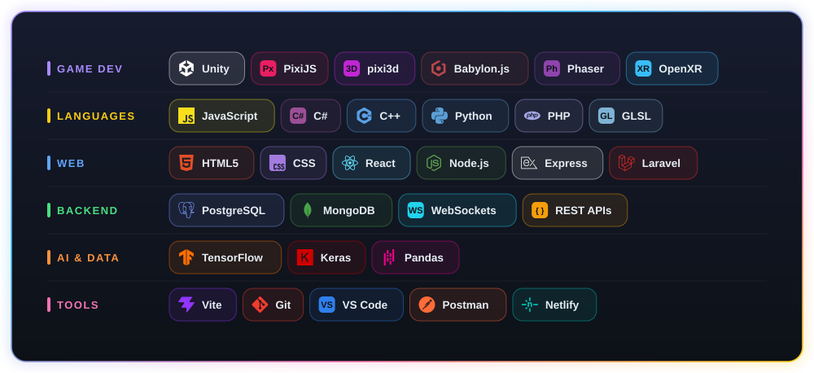

<h1 align="center">Hi 👋, I'm Shifa Khatri</h1>
<h3 align="center">🎮 Game Developer &nbsp;|&nbsp; 💻 Full Stack Web Developer &nbsp;|&nbsp; 🚀 Always Exploring</h3>

  

  I build games for the browser and for Unity: 3D tower defense, match-3 puzzlers, particle toys and arcade classics. 
  I also build full-stack web apps with real-time features and secure backends.

---

## 🧰 Tech Stack

  

---

## 🎮 Game Development

<i>Gameplay mechanics · UI · AI behaviour · particle systems · custom GLSL shaders · GLB/glTF models · Web Audio · PWAs</i>

### 🕹️ Projects

  

 

  &nbsp;
  

 

  &nbsp;
  

---

## 💻 Web Development

<i>Full-stack apps · real-time dashboards · authentication · admin panels · REST APIs · secure backends</i>

### 🚀 Projects

  &nbsp;
  

### 🧪 Mini Projects

| Project | What it does | Stack |
| --- | --- | --- |
| 📊 [**Business Intelligence**](https://github.com/FluffyCrunch/Mini-Projects/tree/main/BI) | Data analysis, visualisation and insight generation | Pandas · Matplotlib · Seaborn |
| ⚡ [**Huffman Encoding on GPU**](https://github.com/FluffyCrunch/Mini-Projects/tree/main/HPC) | Huffman compression accelerated on the GPU | Python · CuPy |
| 💬 [**Real-Time Search Engine**](https://github.com/FluffyCrunch/Mini-Projects/tree/main/NLP) | AI search that answers with context from live results | Google Search API · Groq (Llama3-70b) |
| 🤖 [**Colorizing B&W Images**](https://github.com/FluffyCrunch/Mini-Projects/tree/main/DL) | CNN that automatically colourises grayscale photos | TensorFlow · Keras |

---

## 🌐 Connect with Me

  
  
  

⭐️ From <a href="https://github.com/FluffyCrunch">FluffyCrunch</a>

