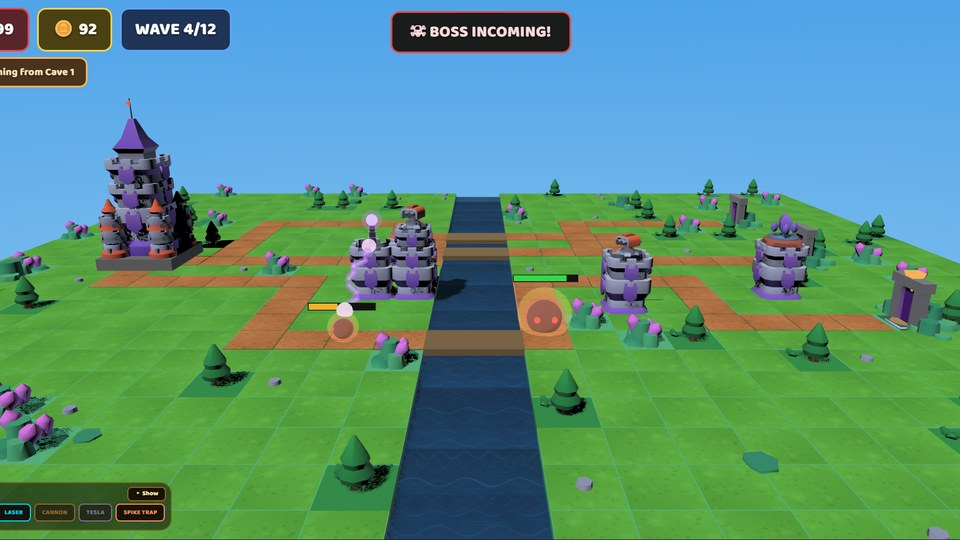
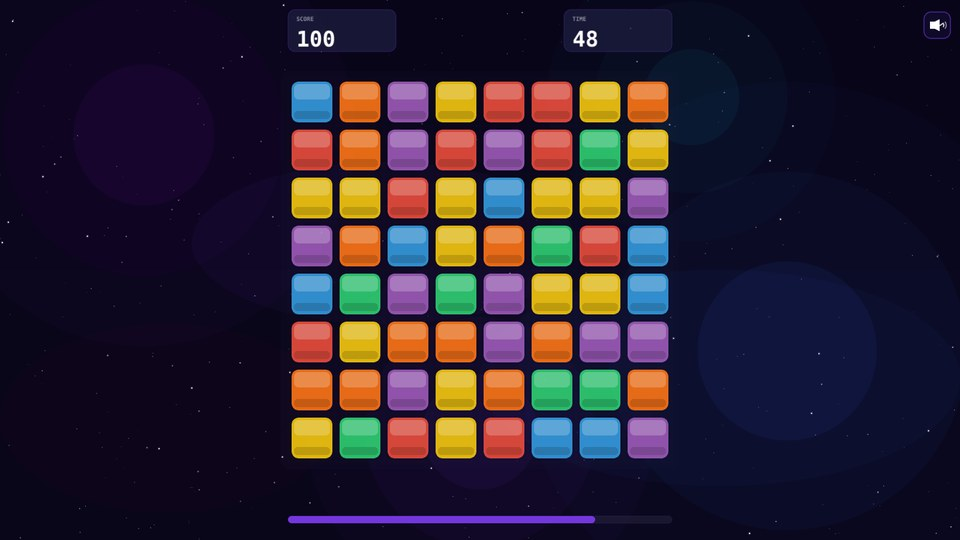
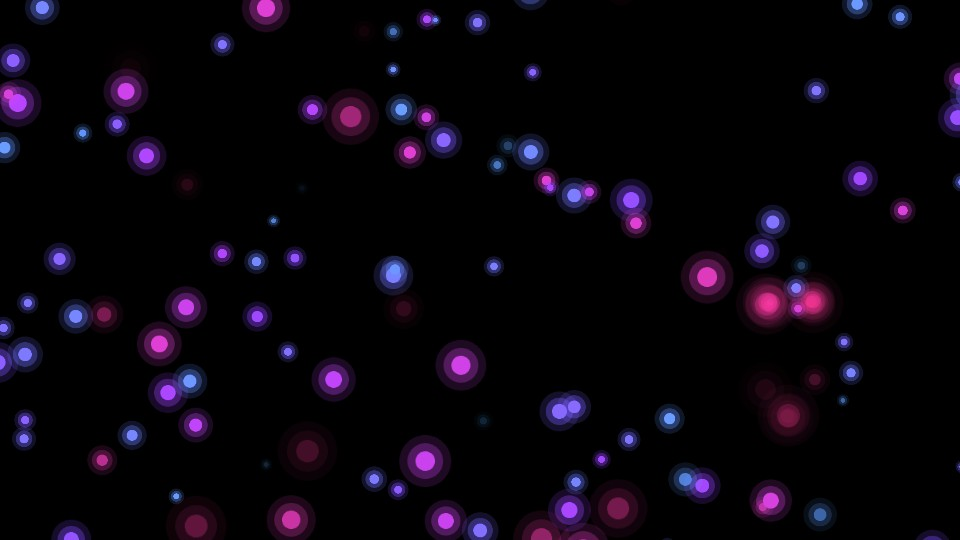
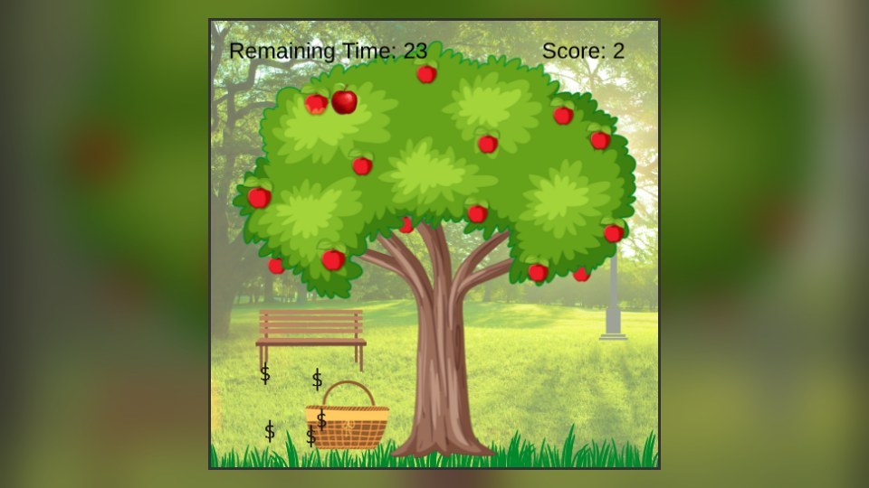
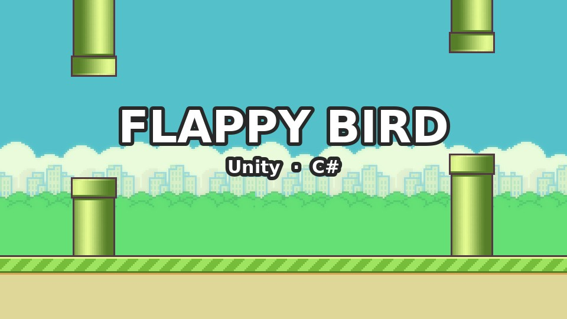

<h1 align="center">Hi 👋, I'm Shifa Khatri</h1>
<h3 align="center">🎮 Game Developer &nbsp;|&nbsp; 💻 Full Stack Web Developer &nbsp;|&nbsp; 🚀 Always Exploring</h3>

  

  I build games for the browser and for Unity: 3D tower defense, match-3 puzzlers, particle toys and arcade classics. 
  I also build full-stack web apps with real-time features and secure backends.

---

## 🎮 Game Development

  

**Engines & tools:** Unity (2D/3D) · PixiJS (v7 & v8) · pixi3d · Babylon.js · Phaser.js · OpenXR (VR) 
**I work on:** gameplay mechanics, UI, AI behaviour, particle systems, custom GLSL shaders, GLB/glTF models, Web Audio, PWAs

### 🕹️ Projects

<table>
  <tr>
    <td width="55%" valign="top">
      
    </td>
    <td width="45%" valign="top">
      <h3>🏰 Void Rush</h3>
      
A 3D tower defense game, built twice on the same game data, once in <b>PixiJS + pixi3d</b> and once in <b>Babylon.js</b>.

      
Place Frost, Laser, Cannon, Tesla and Spike Trap towers, unlock branching upgrades, and hold off 12 waves, including boss fights.

      

        
        
        
        
      

      

        <a href="https://voidrushpixi.netlify.app/"><b>▶️ Play</b></a> &nbsp;·&nbsp;
        <a href="https://github.com/FluffyCrunch/Pixi/tree/main/Void-Rush"><b>💻 Code</b></a>
      

    </td>
  </tr>
</table>

<table>
  <tr>
    <td width="50%" valign="top">
      
      <h3>💎 Crystalux</h3>
      
A 60-second match-3 gem puzzler. Chain cascades into combos, set off bomb gems, and chase a 3-star rating. Touch-friendly, with hints, particles, music and SFX.

      

        
        
      

      <a href="https://crystalux.netlify.app/"><b>▶️ Play</b></a> &nbsp;·&nbsp;
      <a href="https://github.com/FluffyCrunch/Pixi/tree/main/Crystalux"><b>💻 Code</b></a>
    </td>
    <td width="50%" valign="top">
      
      <h3>🌌 Nebula</h3>
      
An interactive cosmic particle experience. 2,000 pooled particles drift with noise-based motion. Move to attract them, click to burst. Uses a custom GLSL shader and installs as a PWA.

      

        
        
      

      <a href="https://nebula-pixijs.netlify.app/"><b>▶️ Try it</b></a> &nbsp;·&nbsp;
      <a href="https://github.com/FluffyCrunch/Pixi/tree/main/Nebula"><b>💻 Code</b></a>
    </td>
  </tr>
  <tr>
    <td width="50%" valign="top">
      
      <h3>🍎 Apple Catcher</h3>
      
A 30-second browser arcade game. Move the basket to catch falling apples, with arcade physics, particle effects, sound and live scoring.

      

        
        
      

      <a href="https://github.com/FluffyCrunch/Phaser/tree/main/AppleCatcher"><b>💻 Code</b></a>
    </td>
    <td width="50%" valign="top">
      
      <h3>🐦 Flappy Bird</h3>
      
The classic, recreated in Unity. Tap-to-flap physics, randomly placed pipes, a parallax background, scoring and a game-over flow, all written in C#.

      

        
        
      

      <a href="https://github.com/FluffyCrunch/Unity-Game/tree/main/Flappy_Bird"><b>💻 Code</b></a>
    </td>
  </tr>
</table>

---

## 💻 Web Development

  

**Languages & frameworks:** HTML · CSS · JavaScript · PHP · Python · C++ · React · Laravel · Node.js 
**Backends & data:** PostgreSQL · MongoDB · WebSockets · REST APIs

### 🚀 Projects

<table>
  <tr>
    <td width="50%" valign="top">
      <h3>🚀 IITIAN CRAFT Website</h3>
      
First draft of the official IITIAN CRAFT site. A full-stack app with user auth, an admin dashboard, contact forms, demo booking and Google Meet scheduling.

      

        
        
        
        
      

      <a href="https://github.com/FluffyCrunch/Online-Digital-Services-Website"><b>💻 Code</b></a>
    </td>
    <td width="50%" valign="top">
      <h3>🔐 Vulnerability Scanner</h3>
      
A web application vulnerability scanner with a real-time dashboard. Scan progress streams live over WebSockets, results are stored in PostgreSQL, and it sends notifications.

      

        
        
        
      

      <a href="https://github.com/FluffyCrunch/Web-Application-Vulnerability-Scanner/tree/main/Vulnerability-Scanner"><b>💻 Code</b></a>
    </td>
  </tr>
</table>

### 🧪 Mini Projects

| Project | What it does | Stack |
| --- | --- | --- |
| 📊 [**Business Intelligence**](https://github.com/FluffyCrunch/Mini-Projects/tree/main/BI) | Data analysis, visualisation and insight generation | Pandas · Matplotlib · Seaborn |
| ⚡ [**Huffman Encoding on GPU**](https://github.com/FluffyCrunch/Mini-Projects/tree/main/HPC) | Huffman compression accelerated on the GPU | Python · CuPy |
| 💬 [**Real-Time Search Engine**](https://github.com/FluffyCrunch/Mini-Projects/tree/main/NLP) | AI search that answers with context from live results | Google Search API · Groq (Llama3-70b) |
| 🤖 [**Colorizing B&W Images**](https://github.com/FluffyCrunch/Mini-Projects/tree/main/DL) | CNN that automatically colourises grayscale photos | TensorFlow · Keras |

---

## 🌐 Connect with Me

  
  
  

⭐️ From <a href="https://github.com/FluffyCrunch">FluffyCrunch</a>

