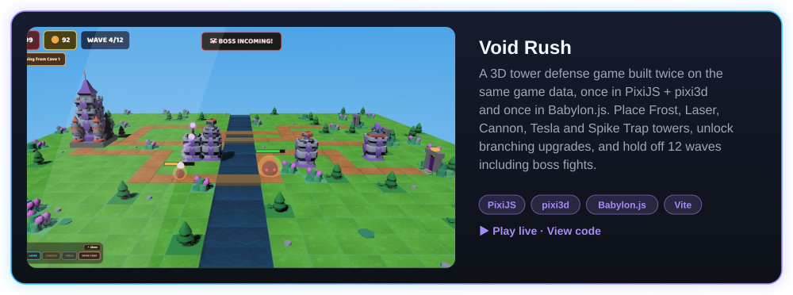
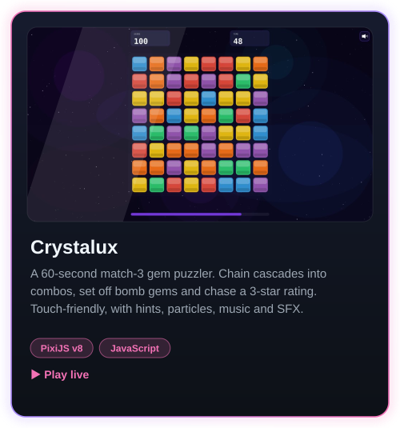
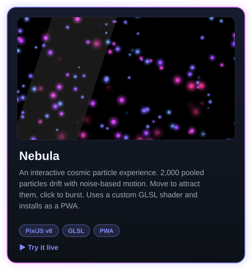
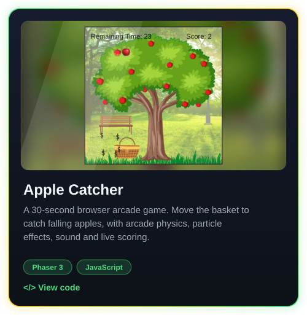
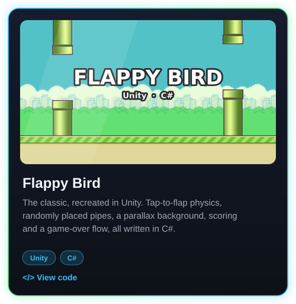
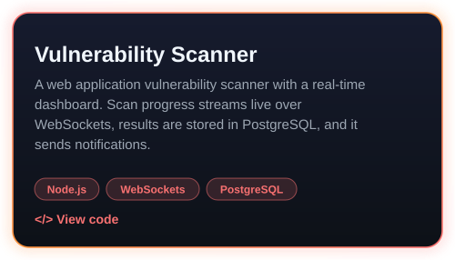

<h1 align="center">Hi 👋, I'm Shifa Khatri</h1>
<h3 align="center">🎮 Game Developer &nbsp;|&nbsp; 💻 Full Stack Web Developer &nbsp;|&nbsp; 🚀 Always Exploring</h3>

  

  I build games for the browser and for Unity: 3D tower defense, match-3 puzzlers, particle toys and arcade classics. 
  I also build full-stack web apps with real-time features and secure backends.

---

## 🎮 Game Development

  

**Engines & tools:** Unity (2D/3D) · PixiJS (v7 & v8) · pixi3d · Babylon.js · Phaser.js · OpenXR (VR) 
**I work on:** gameplay mechanics, UI, AI behaviour, particle systems, custom GLSL shaders, GLB/glTF models, Web Audio, PWAs

### 🕹️ Projects

  

<b>Void Rush</b>: <a href="https://voidrushpixi.netlify.app/">▶️ Play</a> · <a href="https://github.com/FluffyCrunch/Pixi/tree/main/Void-Rush">💻 Code</a>

 

  &nbsp;
  

<b>Crystalux</b>: <a href="https://crystalux.netlify.app/">▶️ Play</a> · <a href="https://github.com/FluffyCrunch/Pixi/tree/main/Crystalux">💻 Code</a> &nbsp;&nbsp;|&nbsp;&nbsp; <b>Nebula</b>: <a href="https://nebula-pixijs.netlify.app/">▶️ Try it</a> · <a href="https://github.com/FluffyCrunch/Pixi/tree/main/Nebula">💻 Code</a>

 

  &nbsp;
  

<b>Apple Catcher</b>: <a href="https://github.com/FluffyCrunch/Phaser/tree/main/AppleCatcher">💻 Code</a> &nbsp;&nbsp;|&nbsp;&nbsp; <b>Flappy Bird</b>: <a href="https://github.com/FluffyCrunch/Unity-Game/tree/main/Flappy_Bird">💻 Code</a>

---

## 💻 Web Development

  

**Languages & frameworks:** HTML · CSS · JavaScript · PHP · Python · C++ · React · Laravel · Node.js 
**Backends & data:** PostgreSQL · MongoDB · WebSockets · REST APIs

### 🚀 Projects

  &nbsp;
  

<b>IITIAN CRAFT Website</b>: <a href="https://github.com/FluffyCrunch/Online-Digital-Services-Website">💻 Code</a> &nbsp;&nbsp;|&nbsp;&nbsp; <b>Vulnerability Scanner</b>: <a href="https://github.com/FluffyCrunch/Web-Application-Vulnerability-Scanner/tree/main/Vulnerability-Scanner">💻 Code</a>

### 🧪 Mini Projects

| Project | What it does | Stack |
| --- | --- | --- |
| 📊 [**Business Intelligence**](https://github.com/FluffyCrunch/Mini-Projects/tree/main/BI) | Data analysis, visualisation and insight generation | Pandas · Matplotlib · Seaborn |
| ⚡ [**Huffman Encoding on GPU**](https://github.com/FluffyCrunch/Mini-Projects/tree/main/HPC) | Huffman compression accelerated on the GPU | Python · CuPy |
| 💬 [**Real-Time Search Engine**](https://github.com/FluffyCrunch/Mini-Projects/tree/main/NLP) | AI search that answers with context from live results | Google Search API · Groq (Llama3-70b) |
| 🤖 [**Colorizing B&W Images**](https://github.com/FluffyCrunch/Mini-Projects/tree/main/DL) | CNN that automatically colourises grayscale photos | TensorFlow · Keras |

---

## 🌐 Connect with Me

  
  
  

⭐️ From <a href="https://github.com/FluffyCrunch">FluffyCrunch</a>

